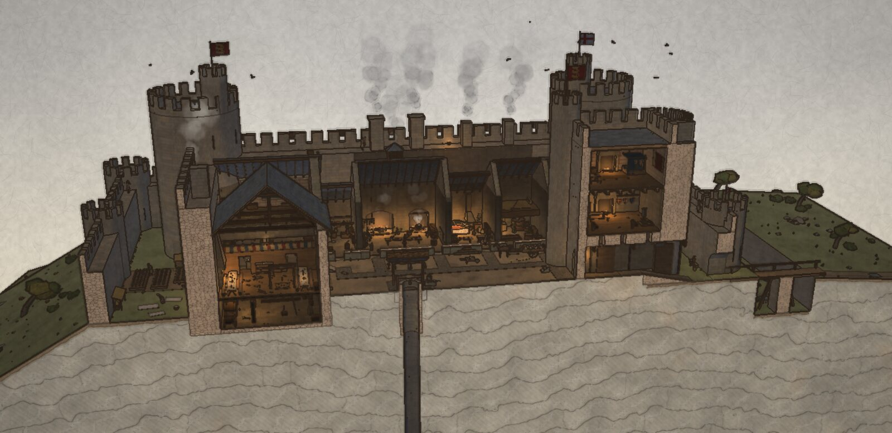
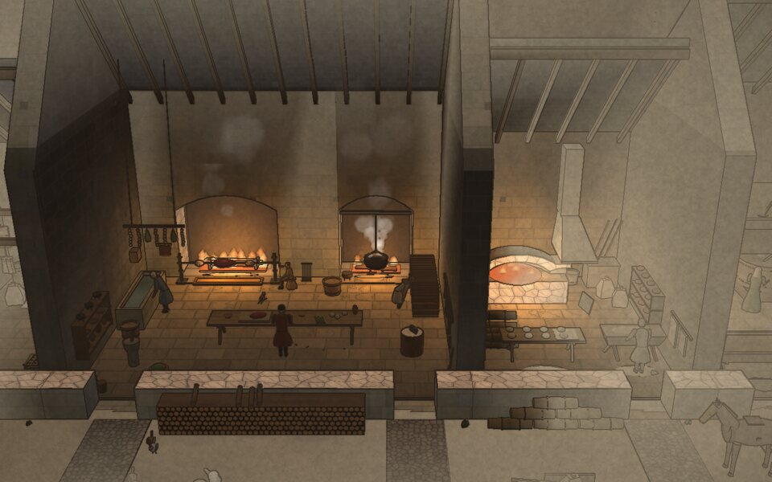
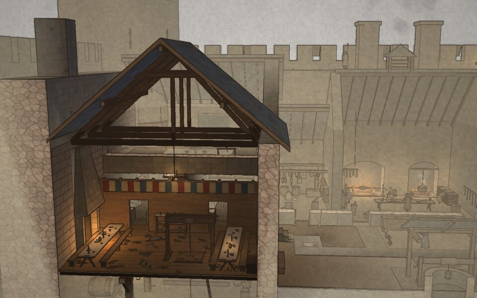
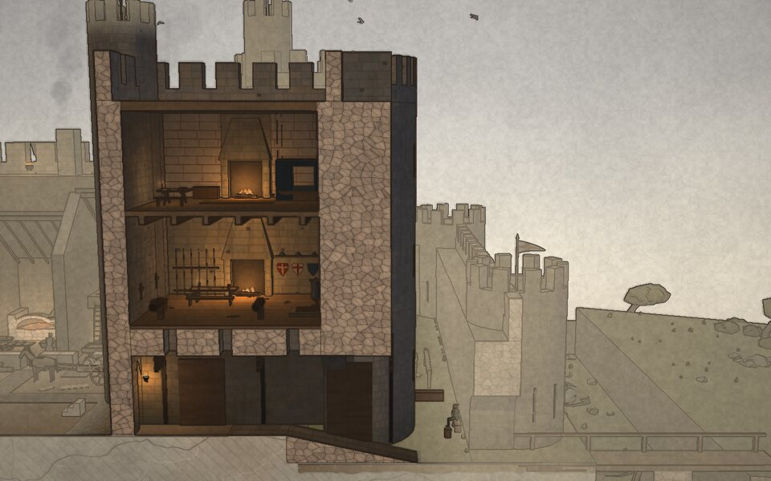
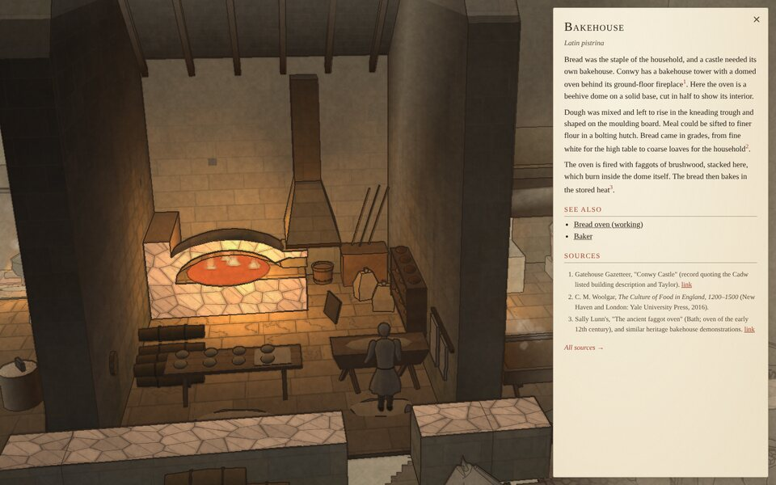
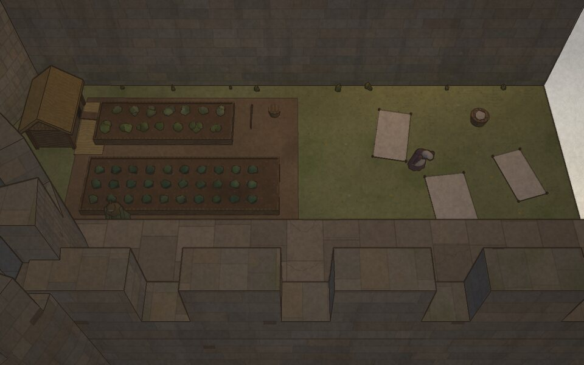
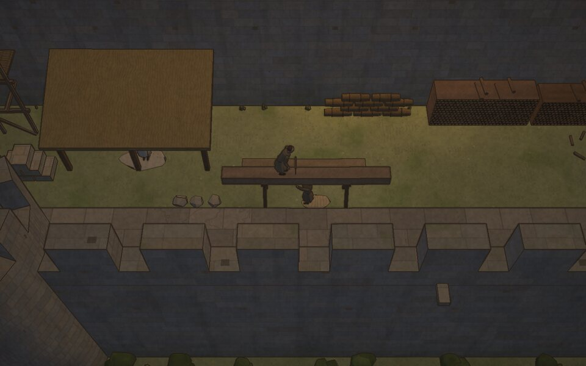
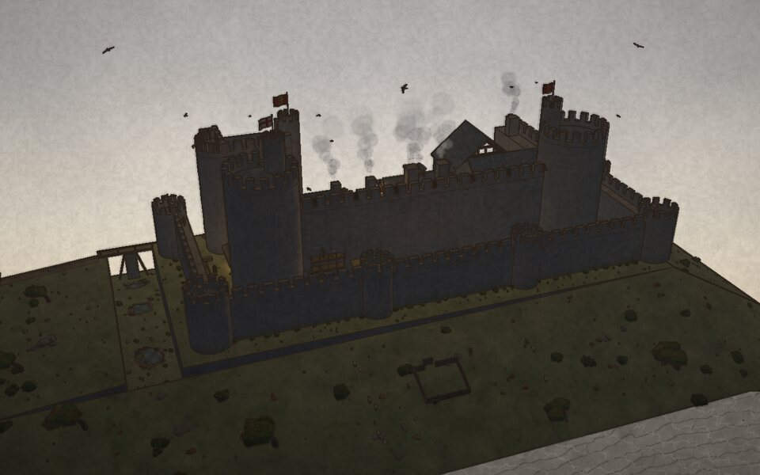

# Aberwen Castle, c. 1290

**An interactive ink-and-watercolour cutaway of a castle that never existed, built the way Edward I's castles in North Wales were.**



Aberwen is a fictional concentric castle modelled on Harlech, Conwy and Beaumaris. It is sliced clean through the gate passage, the well and the great hall, so you look into it like the drawing in a guidebook. The castle is alive inside: on a grey late-autumn morning before dinner, the household is at work in the kitchens, stores and wards. You can orbit it, fly into any room, hover over anything for its proper name, and work the machinery yourself.

Everything is drawn in code: the masonry, the people, the hens and the paper texture. There are no models or image assets.

---

## What's inside

<table>
<tr>
<td width="50%"></td>
<td width="50%"></td>
</tr>
<tr>
<td><b>The kitchen.</b> A spit boy turns the roast, a cauldron hangs over the boiling hearth, the cook dresses dishes, and soot climbs the walls.</td>
<td><b>The great hall.</b> Tables are laid for dinner. The walls are painted with false red joints, rushes are strewn on the floor and the hounds doze by the fire. A trapdoor and hoist lead down to the cellar.</td>
</tr>
<tr>
<td></td>
<td></td>
</tr>
<tr>
<td><b>The gatehouse.</b> Murder holes and three portcullises guard the passage. Above it are the guardroom, hung with spears, shields and crossbows, and a lodging with a curtained bed.</td>
<td><b>The bakehouse,</b> with its beehive oven cut open. Click anything for notes, with numbered sources and honest <i>conjecture</i> marks.</td>
</tr>
<tr>
<td></td>
<td></td>
</tr>
<tr>
<td><b>The outer ward</b> holds a kitchen garden, bee skeps, a hen-house and linen bleaching in the sun…</td>
<td>…along with sawyers, a masons' lodge and scaffold, woodstacks, a smithy, the midden and the porter at the gate.</td>
</tr>
</table>

### The service rooms in full detail

The kitchen, bakehouse, brewhouse, larder, pantry, buttery, cellar, well and store-house are fully furnished. They are stocked with what a 1290 household actually ate and drank. There are no potatoes, no hops and no turkeys.

### People and animals at work

There are over fifty figures and animals, each running its own daily routine:

- **Kitchen and stores:** the cook, scullions, the spit boy, the baker, the brewer, the butler and pantler, the water carrier, and a carter unloading grain while a clerk notches the tally.
- **The watch:** watchmen and a crossbowman walk the wall-walks.
- **The wards:** a smith at the forge, masons and sawyers, a gardener, a laundress, a henwife and the porter.
- **Animals:** hens, hounds, a cat stalking rats in the larder, and sheep with a shepherd's boy on the hill.
- **Overhead:** jackdaws wheel round the towers and the banners stream in the wind.

### Five working mechanisms

| Mechanism | What you can do |
|---|---|
| **Well windlass** | Drag the crank to lower the bucket 24 m. Wind it up full and tip it into the trough. |
| **Roasting spit** | Stop the spit boy and watch one side char, then turn it yourself to brown it evenly. |
| **Bread oven** | Fire it, rake out the embers, swab it, set the loaves with the peel, seal it, bake and draw. |
| **Cellar trapdoor and hoist** | Open the hatch in the hall floor and wind a cask up from the undercroft. |
| **Buttery tap** | Open the faucet with the vent peg shut and the ale glugs and stops. |

### Firelight and the time of day



The default light is a dim, overcast morning. The hearths, candles, lanterns and the forge light the rooms around them. A **Dusk ↔ Day** slider runs from full daylight down to dusk, when the cressets at the gates are lit.

### Old, and lived in

Damp creeps up the wall feet, with rain streaks and lichen above it. Moss grows on the slates, and the flagstones are worn and cracked. Grass grows in the joints of the wall-walk, and there are putlog holes, spouts and scaffolding. Beyond the walls are gorse, russet bracken, wind-bent thorn trees, a rock-cut ditch with standing water, a rutted cart track and a hurdle sheepfold.

---

## Getting it right

The castle is invented, but its parts are not. Every note in the side panel cites its sources: Arnold Taylor's *King's Works in Wales*, C. M. Woolgar's studies of the medieval household and its food, the 1318 Household Ordinance of Edward II, Walter of Bibbesworth on brewing, Peter Brears on cooking and dining, the Morgan Picture Bible, and others.

Where the evidence is thin or the scene has had to invent, the note says so with a **conjecture** mark. [`SOURCES.md`](SOURCES.md) lists every reference and the claims it supports, along with every statement marked as conjecture (36 sources and 39 conjectures at present).

---

## Running it

```sh
npm install
npm run dev      # development server at http://localhost:5173
npm run build    # static production build in dist/ (relative paths; host it anywhere)
npm run preview  # serve the production build
```

### Controls

| | |
|---|---|
| **Orbit** | Drag. You can circle the whole castle; inside a room the view keeps the open side towards you. |
| **Pan** | Right-drag, shift-drag, or WASD / arrow keys (Q / E for down / up). |
| **Zoom** | Scroll; it zooms towards the cursor. |
| **Visit a room** | Click it in the view, the room list or the plan. The rest of the castle fades back. **Esc** or **Back** returns. |
| **Learn** | Hover anything for its name and a one-line gloss. Click a room, mechanism or person for notes and sources. |
| **Light** | Use the Dusk ↔ Day slider under the plan. |

### Checking a change

```sh
npm run check                          # build, render headless, screenshot, fail on any console error
npm run check -- --shots kitchen,hall  # screenshots of particular rooms (room ids)
npm run check -- --no-build --out DIR  # reuse the last build; choose the output folder
npm run sources                        # regenerate SOURCES.md from src/data/
```

`check` runs the build in headless Chromium with software WebGL. Its frame rate is not representative of a real GPU.

---

## How it's made

Three.js and Vite, in plain JavaScript modules. There are no textures or models: every surface pattern is procedural, generated in the shaders.

- **Real sections.** `src/geom/builder.js` clips every convex solid against the cut plane and generates true cap faces, tagged as section fill. Coplanar T-junctions are welded so no cracks show. Boulders, bushes and trees in `src/geom/nature.js` are built the same way, so they cut cleanly too.
- **One shader, three targets.** The surface shader in `src/render/material.js` writes watercolour colour, view normals and a picking label in a single pass. It draws coursed masonry, slates, boards, flags, cobbles, wattle, painted false-ashlar and log ends, plus the weathering. It also handles daylight that dims indoors and up to 24 flickering fire lights.
- **Ink and paper.** A post pass in `src/render/post.js` finds edges from depth, normals and labels, and draws them as wobbling, dry-brushed ink. It then pools pigment at wash edges, granulates it into the paper tooth and prints the whole frame on paper. Smoke, steam, flames and light halos are watercolour particles (`src/render/fx.js`).
- **People.** The figures in `src/people/` are articulated, built from smooth pleated surfaces of revolution and driven by looping routines of walks and poses. `life.js` populates the wards and fields. `banners.js` ripples the flags with smooth cloth normals.
- **The castle.** `src/castle/` holds the layout, the shell (curtains, towers, gatehouse, ranges, rock), the furnished rooms (`furnish.js`, `interiors.js`), the wards (`wards.js`), the landscape (`landscape.js`), and the fires and smoke (`ambient.js`).
- **Mechanisms** live in `src/mech/`. **Glossary, notes and sources** live in `src/data/`.

All code and art are original.
